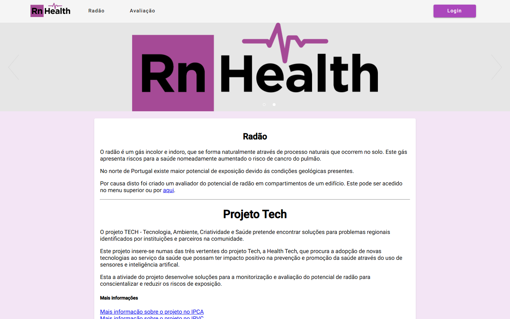
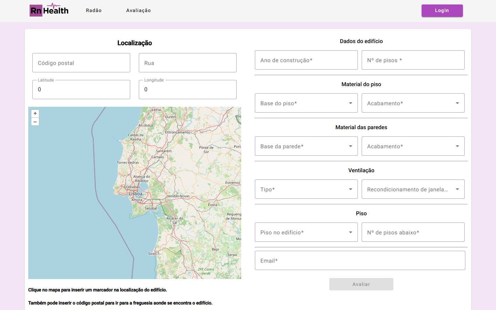

# RnHealth: radon risk, assessed by citizens

A citizen-science web platform for indoor radon. Radon is a radioactive gas that seeps up from
the ground and builds up indoors; it is the second leading cause of lung cancer, and northern
Portugal, with its granite bedrock, has some of the highest exposure in the country.

Anyone can describe a room in their home (where the building is, how old it is, what the floor
and walls are made of, how it is ventilated) and get an estimate of its radon potential from a
machine-learning model. People who then measure the real value with a detector can add the
reading, and those readings are what lets the model be checked and retrained.

I built it in 2023 at [2Ai](https://2ai.ipca.pt/) (IPCA), as part of the Health Tech line of the
TECH project (Tecnologia, Ambiente, Criatividade e Saúde). It is the platform behind two papers:

- **A Pre-Diagnosis Model for Indoor Radon Potential Assessment.** ISDFS 2023, IEEE.
  [doi:10.1109/ISDFS58141.2023.10131887](https://doi.org/10.1109/ISDFS58141.2023.10131887)
- **Citizen Science Platform for Radon Potential Assessment and Radon Risk Awareness.** IADIS
  Connected Smart Cities 2023, pp. 227–234.
  [IADIS digital library](https://iadisportal.org/digital-library/citizen-science-platform-for-radon-potential-assessment-and-radon-risk-awareness)

The interface is in Portuguese.





## What it does

- **Evaluation.** The user places the building on an OpenStreetMap map (or searches by postcode)
  and fills in the building and room. The API looks up the ground's natural gamma radiation at
  that point from LNEG's national radiometric map, then classifies the room as low, medium or
  high radon potential with a random-forest model.
- **Private links, no accounts.** Each evaluation gets an emailed link to see it and to add a
  detector reading later, plus a second link listing every evaluation made with that email.
- **Admin dashboard.** Evaluations and readings in tables and on a map, statistics by region
  (NUTS I–III, district, municipality), the model's F-score against the real readings, and news
  posts for the home page.

## How it's built

| Folder | What |
|---|---|
| `RnAPI/` | The API: Python, FastAPI, scikit-learn, JWT login for admins |
| `Web/` | The front end: Angular 15 + Angular Material, OpenLayers |
| `RnHealthDB/` | MongoDB, seeded with building materials and Portugal's NUTS regions |

`RnAPI/readme.md` maps the API's files.

## Run it

```bash
cp .env.example .env    # then set the passwords, secretKey and admin login
docker compose up --build
```

The site is on http://localhost:50003 and the API on http://localhost:50002 (docs at `/docs`).
Log in with `ADMIN_EMAIL` and `ADMIN_PASSWORD` from `.env`. Email is optional: without an SMTP
account, evaluations are saved but no links are sent.

### The model

`RnAPI/randomForest.joblib` is the trained random forest, saved with
[skops](https://skops.readthedocs.io/); its features are listed in `RnAPI/model/modelLib.py`.
The data it was trained on belongs to the research project and is not published here.

## Status

Built in 2023 and not maintained. It is published as it was, with the credentials taken out
of the code and of its history.

## Licence

MIT, see [LICENSE](LICENSE). The partner and funding logos in `Web/src/assets` belong to their
organisations.
